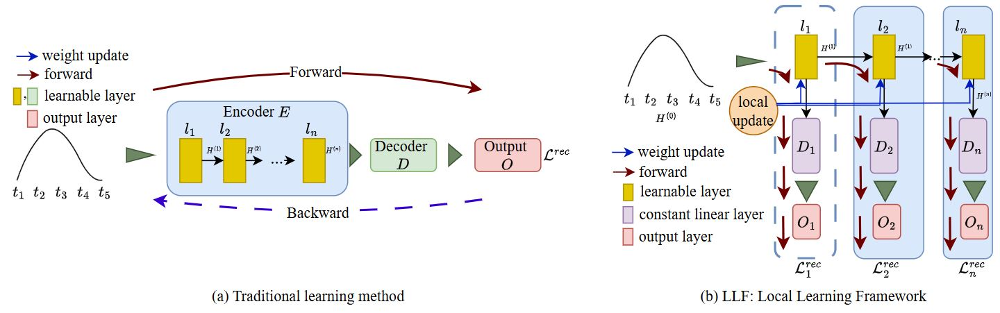
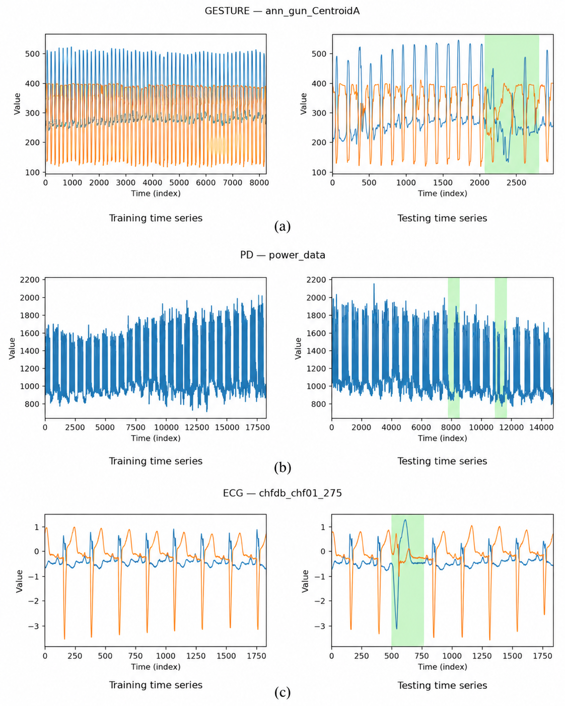
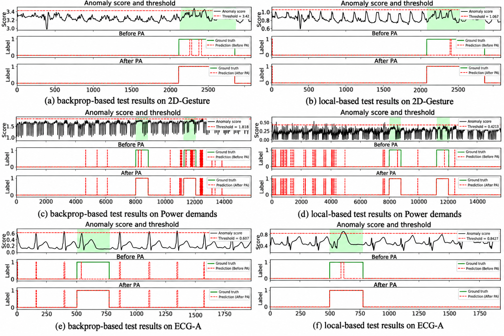

# Layer-Local Reconstruction Learning for Time-Series Anomaly Detection

This repository contains the implementation and experimental results of our research on unsupervised time-series anomaly detection using a simple temporal convolutional network trained with layer-local reconstruction objectives.

## Abstract

Deep time-series anomaly detection (TSAD) often relies on increasingly complex architectures and globally coupled backpropagation, which increase activation-memory demands and optimization dependencies. We investigate whether competitive anomaly detection can instead be achieved with a simple temporal model trained through local learning. We propose a reconstruction-based framework in which each temporal module is optimized using a layer-local mean-squared reconstruction objective, with detached intermediate representations and fixed decoder-side mappings. Evaluated on six ECG series, Power Demand, and 2D-Gesture using PA-F1, the proposed method achieves 98.23%, 96.61%, and 99.80%, respectively, exceeding the strongest compared baseline by 3.76, 0.55, and 1.33 percentage points. These results show that layer-local optimization can achieve competitive PA-F1 performance with a deliberately simple temporal architecture, supporting local learning as an alternative to globally coupled training for unsupervised TSAD.

## Main Contributions

1. **Overall Architecture**
   - We formulate unsupervised TSAD using a simple four-module temporal convolutional network (TCN).
   - Each temporal module is optimized using its own local reconstruction objective instead of a single globally backpropagated loss.
   - The proposed method achieves PA-F1 scores of 98.23% on ECG, 96.61% on Power Demand, and 99.80% on 2D-Gesture.



2. **Layer-Local Learning**
   - Intermediate representations are detached using a stop-gradient operation before each local update.
   - Only the parameters of the current temporal layer are updated by its corresponding reconstruction loss.
   - Fixed decoder-side mappings transform local representations back to the input feature space without introducing additional trainable dependencies.
   - The epoch-based training order is `epoch -> layer -> mini-batch`.

3. **Reconstruction-Based Anomaly Detection**
   - Mean squared error (MSE) is used as the local reconstruction loss during training.
   - During testing, the reconstruction produced by the final temporal layer is used to calculate an anomaly score for every timestep.
   - The anomaly score is the Euclidean (`L2`) distance across the feature dimension:

$$
s_t = \left\|\mathbf{x}_t-\widehat{\mathbf{x}}^{(L)}_t\right\|_2
= \sqrt{\sum_{d=1}^{D}\left(x_{t,d}-\widehat{x}^{(L)}_{t,d}\right)^2}.
$$

## Implementation

### 1. Data Preprocessing

- [`data_processing/ds_reader.py`](data_processing/ds_reader.py) loads, normalizes, and converts each time series into overlapping sliding windows.
- The normalization parameters are calculated from the training data and then applied to the test data.
- Input windows use the tensor format `(batch, time, features)`.
- [`data_processing/mask.py`](data_processing/mask.py) creates masked inputs and their corresponding reconstruction targets.

Expected dataset structure:

```text
dataset/
├── ecg/
│   └── labeled/
│       ├── train/
│       └── test/
├── gesture/
│   └── labeled/
│       ├── train/
│       └── test/
└── pd/
    └── labeled/
        ├── train/
        └── test/
```

### 2. Local-Learning Model

- [`modules/tcn_based/tcnBlock2.py`](modules/tcn_based/tcnBlock2.py) implements the temporal block with causal convolutions, batch normalization, ReLU activation, dropout, and a residual connection.
- [`modules/tcn_based/tcnNet.py`](modules/tcn_based/tcnNet.py) constructs the multi-layer local TCN.
- [`modules/constantDecoder.py`](modules/constantDecoder.py) implements `FixedReadout`. Its decoder matrix is registered as a non-trainable buffer.
- [`train_test/loss_eval.py`](train_test/loss_eval.py) implements the MSE reconstruction loss.
- [`train_test/model_training.py`](train_test/model_training.py) contains epoch-based local training and the global-backpropagation counterpart.

For epoch-based local learning, set the training type passed to `train()` to:

```python
train_type=1
```

For the global-backpropagation counterpart, use:

```python
train_type=2
```

Use a different checkpoint directory for every experiment so that local and backpropagation runs are not overwritten.

### 3. Model Testing

- [`train_test/model_testing.py`](train_test/model_testing.py) loads trained checkpoints, reconstructs the test sequence, calculates the `L2` anomaly score, searches for the evaluation threshold, and reports precision, recall, and PA-F1.
- [`train_test/plot_results.py`](train_test/plot_results.py) plots anomaly scores and predictions before and after point adjustment.
- The current testing protocol uses `w == predicted_length` and batch size `1` to combine scores from overlapping windows.

Select the checkpoint paths in `model_testing.py` before running an evaluation. The architecture and preprocessing arguments used during testing must match those used to train the checkpoint.

### 4. Running the Code

Clone the repository and enter the project directory:

```bash
git clone https://github.com/AIC-Lab-FUHCM/Layerwise-Learning.git
cd Layerwise-Learning
```

Create and activate a virtual environment:

```bash
python -m venv .venv
```

Windows PowerShell:

```powershell
.\.venv\Scripts\Activate.ps1
```

Linux:

```bash
source .venv/bin/activate
```

Install the dependencies:

```bash
python -m pip install --upgrade pip
python -m pip install -r requirements.txt
```

Example: train and test on 2D-Gesture:

```bash
python main.py -mode train --dataset gesture --dimension 2 --data_source ./dataset/gesture/ --save_path ./checkpoints/ -encoder b_tcn -w 16 -predicted_length 16 -n_epochs 300 -lr 0.0001

python main.py -mode test --dataset gesture --dimension 2 --data_source ./dataset/gesture/ --save_path ./checkpoints/ -encoder b_tcn -w 16 -predicted_length 16
```

Example: train and test on Power Demand:

```bash
python main.py -mode train --dataset pd --dimension 1 --data_source ./dataset/pd/ --save_path ./checkpoints/ -encoder b_tcn -w 16 -predicted_length 16 -n_epochs 300 -lr 0.0001

python main.py -mode test --dataset pd --dimension 1 --data_source ./dataset/pd/ --save_path ./checkpoints/ -encoder b_tcn -w 16 -predicted_length 16
```

Example: train and test on ECG-A:

```bash
python main.py -mode train --dataset ecg --dimension 2 --ts_num 0 --data_source ./dataset/ecg/ --save_path ./checkpoints/ -encoder b_tcn -tcn_channels 16 32 32 64 -w 32 -predicted_length 32 -n_epochs 300 -lr 0.005

python main.py -mode test --dataset ecg --dimension 2 --ts_num 0 --data_source ./dataset/ecg/ --save_path ./checkpoints/ -encoder b_tcn -tcn_channels 16 32 32 64 -w 32 -predicted_length 32
```

## Experimental Results

### Datasets

The experiments use six ECG series, Power Demand, and 2D-Gesture.

| Dataset      | File                    | Dimensions |  Train |   Test | Anomaly ratio |
| ------------ | ----------------------- | ---------: | -----: | -----: | ------------: |
| ECG-A        | `chfdb_chf01_275.pkl`   |          2 |  1,833 |  1,841 |        14.61% |
| ECG-B        | `chfdb_chf13_45590.pkl` |          2 |  2,439 |  1,287 |        12.35% |
| ECG-C        | `chfdbchf15.pkl`        |          2 | 10,863 |  3,348 |         4.45% |
| ECG-D        | `ltstdb_20221_43.pkl`   |          2 |  2,610 |  1,121 |        11.51% |
| ECG-E        | `ltstdb_20321_240.pkl`  |          2 |  2,011 |  1,447 |         9.61% |
| ECG-F        | `mitdb__100_180.pkl`    |          2 |  2,943 |  2,255 |         8.38% |
| Power Demand | `power_data.pkl`        |          1 | 18,145 | 14,786 |        10.39% |
| 2D-Gesture   | `ann_gun_CentroidA.pkl` |          2 |  8,251 |  3,000 |        24.63% |



- Dataset link: [Datasets](https://drive.google.com/drive/folders/1yv1po9kwN9mpreh82qyh33HJgGPmUEkO?usp=drive_link)

The dataset preparation follows the benchmark setup used in:

> H. C. V. Ngu and K. M. Lee, "CL-TAD: A Contrastive-Learning-Based Method for Time Series Anomaly Detection," _Applied Sciences_, vol. 13, no. 21, Art. no. 11938, 2023. [https://doi.org/10.3390/app132111938](https://doi.org/10.3390/app132111938)

### Hyperparameters

| Dataset      | Activation | TCN channels       | Scheduler | Window | Kernel | Batch | Epochs | Dropout | Learning rate |
| ------------ | ---------- | ------------------ | --------- | -----: | -----: | ----: | -----: | ------: | ------------: |
| ECG          | ReLU       | `[16, 32, 32, 64]` | True      |     32 |      3 |   256 |    300 |     0.2 |         0.005 |
| Power Demand | ReLU       | `[32, 32, 32, 32]` | True      |     16 |      3 |   256 |    300 |     0.2 |        0.0001 |
| 2D-Gesture   | ReLU       | `[32, 32, 32, 32]` | True      |     16 |      3 |   256 |    300 |     0.2 |        0.0001 |

### Comparison with Reconstruction-Based TSAD Methods

All values below are PA-F1 scores reported in the paper.

| Method                    |       ECG | Power Demand | 2D-Gesture |
| ------------------------- | --------: | -----------: | ---------: |
| MSCRED                    |     85.37 |        42.50 |      60.17 |
| OmniAnomaly               |     78.21 |        58.71 |      41.11 |
| TranAD                    |     33.33 |        49.96 |      90.34 |
| Anomaly Transformer       |     94.47 |        96.06 |      98.47 |
| MTAD-GAT                  |     79.19 |        58.78 |      88.87 |
| MAD-GAN                   |     48.81 |        65.75 |      42.47 |
| USAD                      |     62.33 |        95.70 |      93.36 |
| CAE-M                     |     62.32 |        95.52 |      97.94 |
| Ours (backprop-based)     |     93.95 |        96.58 |  **99.93** |
| **Ours (local learning)** | **98.23** |    **96.61** |      99.80 |

### Detailed Results of the Proposed Method

| Dataset      | Local Precision | Local Recall | Local PA-F1 | Backprop Precision | Backprop Recall | Backprop PA-F1 |
| ------------ | --------------: | -----------: | ----------: | -----------------: | --------------: | -------------: |
| ECG-A        |           99.60 |       100.00 |   **99.81** |              88.20 |          100.00 |          93.73 |
| ECG-B        |           99.38 |       100.00 |   **99.69** |              99.38 |          100.00 |      **99.69** |
| ECG-C        |           99.33 |       100.00 |   **99.67** |              69.30 |          100.00 |          81.87 |
| ECG-D        |           92.81 |       100.00 |   **96.27** |              90.85 |          100.00 |          95.20 |
| ECG-E        |           93.29 |       100.00 |   **96.53** |              93.29 |          100.00 |      **96.53** |
| ECG-F        |           94.97 |       100.00 |   **97.42** |              93.56 |          100.00 |          96.68 |
| Power Demand |           93.43 |       100.00 |   **96.61** |              93.37 |          100.00 |          96.58 |
| 2D-Gesture   |           99.60 |       100.00 |       99.80 |              99.86 |          100.00 |      **99.93** |

### Qualitative Test Results

The following figure compares the backpropagation-based model (left) and the proposed local-learning model (right). Each example shows the anomaly score and threshold, followed by predictions before and after point adjustment.



### Evaluation Protocol

- The model is trained without anomaly labels.
- Testing uses the final-layer reconstruction and the `L2` anomaly score.
- The benchmark evaluator searches 800 candidate thresholds and reports the threshold with the highest PA-F1.
- Point adjustment marks an entire ground-truth anomaly interval as detected when at least one point in that interval is detected.
- Threshold selection using test labels is intended for benchmark evaluation. A deployment system should select its threshold using training or validation data.

## Requirements

### Hardware

- NVIDIA GPU with CUDA support
- Sufficient GPU memory for the selected batch size and window length

### Software

- Python 3.10+
- CUDA-enabled PyTorch installation
- Dependencies listed in [`requirements.txt`](requirements.txt)

Core packages include:

```text
torch==2.7.0
torchvision==0.22.0
torchaudio==2.7.0
numpy>=1.26
pandas>=2.2
matplotlib>=3.8
scipy>=1.12
scikit-learn>=1.4
```

Verify the environment with:

```bash
python -c "import torch; print(torch.__version__); print(torch.version.cuda); print(torch.cuda.is_available())"
```

## Authors

- Huynh Kha Tu<sup>a</sup> (hktu2004@gmail.com)
- Huynh Cong Viet Ngu<sup>a,</sup>\* (nguhcv@fe.edu.vn)

<sup>a</sup>(AI-Cybersecurity Laboratory AIC Lab), FPT University, Ho Chi Minh City, Vietnam.

\* Corresponding author

You can explore related research papers and projects from our laboratory at [AIC-Lab](https://github.com/AIC-Lab-FUHCM).
